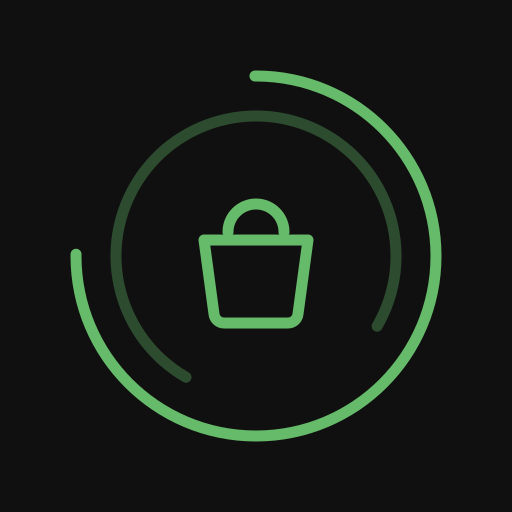
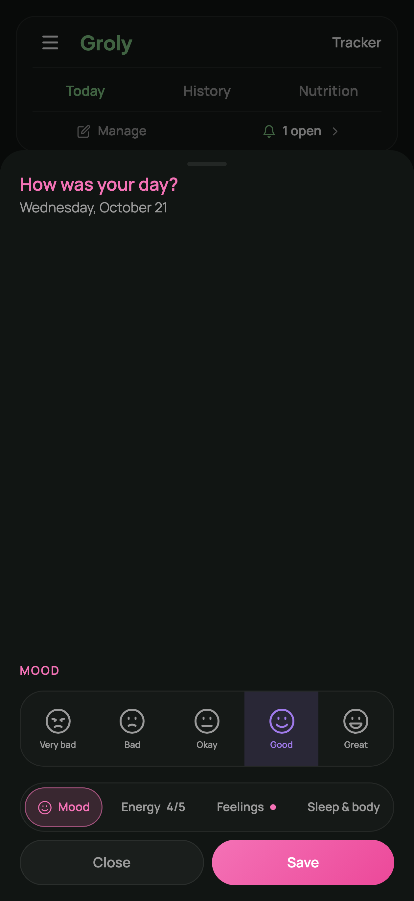
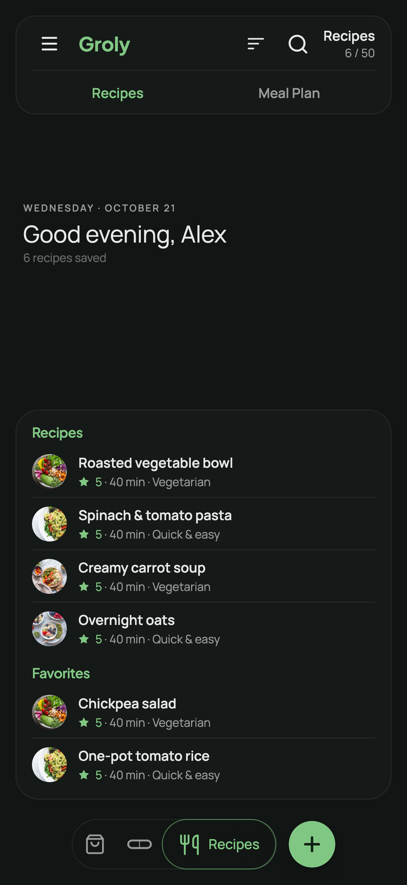
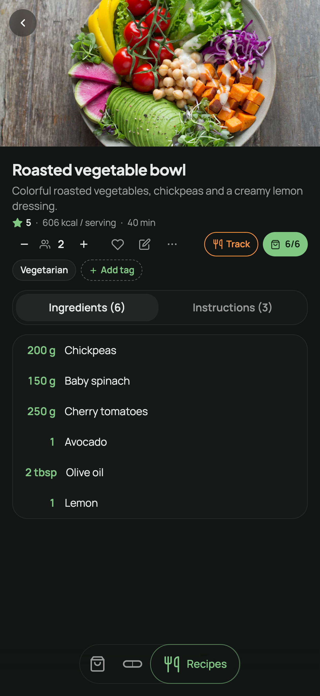

# Groly

<p align="center">
  
</p>

Groly is a self-hosted app for **grocery lists, recipes, meal planning, and health and nutrition tracking**. The mobile interface puts navigation and main actions at the bottom of the screen, within thumb reach, so you can quickly add and check off shopping items.

Shopping lists work **offline** and sync automatically when you reconnect. You can also share lists with other users to shop together, with changes synced in real time.

Import recipes from websites, add ingredients to shopping lists, and plan meals for the week. Track calories, macronutrients, supplements, water, caffeine, mood, and meditation, with goals, reminders, and history views. More features and screenshots are listed below.

Run Groly on your own server with **Docker Compose** or install it through **Unraid Community Applications**. Use it in a browser on your phone or computer, or add it to your home screen on iOS or Android as a **Progressive Web App (PWA)**.

See the [deployment guides](#deployment) for Docker Compose, Unraid, Synology, TrueNAS, QNAP, and Portainer.

**HTTPS is required** for offline mode, PWA installation, push notifications, barcode scanning, and location-based list opening. The admin invites users via one-time links; there is no public registration.

## Features

### Shopping Lists

<table align="center">
  <thead>
    <tr>
      <th align="center">Overview</th>
      <th align="center">Shopping list</th>
      <th align="center">Favourites</th>
    </tr>
  </thead>
  <tbody>
    <tr>
      <td align="center"></td>
      <td align="center"></td>
      <td align="center"></td>
    </tr>
  </tbody>
</table>

Shared, offline-first shopping lists with real-time sync, smart suggestions, barcode scanning, and automatic categorization.

<details>
<summary><strong>Show all shopping-list features</strong></summary>

#### Features

- **Shared lists** – Share lists with other users; changes sync in real time via Server-Sent Events.
- **Offline-first** – Add, check off, edit, and delete items without internet. Changes sync automatically when back online.
- **Barcode scan** – Scan product barcodes with your camera to add items directly to your list (iOS and Android). Uses the native [BarcodeDetector API](https://developer.mozilla.org/en-US/docs/Web/API/BarcodeDetector) where available (Chrome/Android) with [ZBar WASM](https://github.com/undecaf/zbar-wasm) as a fallback for iOS and Firefox. Product names are looked up via [Open Food Facts](https://world.openfoodfacts.org/), [Open Products Facts](https://world.openproductsfacts.org/), and [Open Beauty Facts](https://world.openbeautyfacts.org/) — open, community-maintained product databases covering food, household, and personal care items. No API key required. Lookups are routed through your server (user IPs are not exposed) and cached persistently in SQLite. An offline indicator is shown in the scanner when there is no internet connection.
- **Category sorting** – Items are automatically assigned a category based on keyword matching (e.g. "milk" → Dairy, "apple" → Fruit & Vegetables). The display order of categories can be customized in Settings to match your supermarket layout — globally or individually per list. Users can also override the category of any single item.
- **Quick entry** – Add multiple items at once by separating them with commas — e.g. `2x Milk, 500g Ground beef, Bread`. Quantities at the start of each item are recognized automatically.
- **Smart suggestions** – When adding items, previously used item names are suggested. Suggestions are tracked per user in a dedicated history table and ranked by usage frequency. Checked-off items older than 60 days are automatically removed from the database; suggestion history is retained for 6 months after last use.
- **Swipe to peek** – Swipe left or right on any item tile whose name is truncated to reveal the full name in an overlay, without accidentally checking it off.
- **Favourites** – Long-press an item and tap the star next to the quantity field to save it as a favourite. Favourited items are marked with a small green dot on their tile (can be turned off in Settings → Display). Open the favourites panel via + → Favourites to quickly re-add them to any list, sorted by category. Long-press a favourite card to remove it.

</details>

### Tracker

<table align="center">
  <thead>
    <tr>
      <th align="center">Today</th>
      <th align="center">Quick log</th>
      <th align="center">Weekly history</th>
    </tr>
  </thead>
  <tbody>
    <tr>
      <td align="center"></td>
      <td align="center"></td>
      <td align="center"></td>
    </tr>
  </tbody>
</table>

A unified health & lifestyle tracker — supplements, water, caffeine, meditation, and mood — each with a quick-log sheet and day/week/month history.

<details>
<summary><strong>Show all tracker features</strong></summary>

#### More screenshots

<table align="center">
  <thead>
    <tr>
      <th align="center">Tracker log</th>
      <th align="center">Mood</th>
      <th align="center">Daily history</th>
    </tr>
  </thead>
  <tbody>
    <tr>
      <td align="center"></td>
      <td align="center"></td>
      <td align="center"></td>
    </tr>
  </tbody>
</table>

<table align="center">
  <thead>
    <tr>
      <th align="center">Monthly history</th>
      <th align="center">Manage</th>
      <th align="center">Edit</th>
    </tr>
  </thead>
  <tbody>
    <tr>
      <td align="center"></td>
      <td align="center"></td>
      <td align="center"></td>
    </tr>
  </tbody>
</table>

#### Features

- **Supplements** – Quick-log intake (amount + time, one tap). Define nutrients per unit (e.g. 500 µg B12 per capsule) and Groly sums your total daily intake. Track stock and reorder to any list via the cart button. Per-supplement push reminders, active/inactive toggle, optional brand & info.
- **Water** – Log with quick-add presets or a custom amount, set a daily goal (ml) with a fill bar, and schedule interval reminders within a time window.
- **Caffeine** – Log from a built-in drink catalog (10 drinks, per-user default amounts), set a daily limit with a fill bar (red when exceeded), and hide drinks you don't use.
- **Meditation** – Full-screen timer with quick-start presets or a custom duration, preparation phase, Zen progress animation, start/end sounds, daily goal, and optional reminders.
- **Mood** – Log daily mood on a 1–5 scale with an optional gratitude note and optional check-in reminder.
- **History & adherence** – Day, week, and month views for every tracker, with per-supplement adherence rates and heatmaps (scheduled vs. actually taken).
- **PDF export** – Export selected sections (supplements, trackers, mood, nutrients) for any period as a PDF to share with a doctor or trainer. [Example report](docs/pdf/example-report.pdf).

</details>

### Nutrition Tracker

<table align="center">
  <thead>
    <tr>
      <th align="center">Food diary</th>
      <th align="center">Log meal</th>
      <th align="center">Nutrition goals</th>
    </tr>
  </thead>
  <tbody>
    <tr>
      <td align="center"></td>
      <td align="center"></td>
      <td align="center"></td>
    </tr>
  </tbody>
</table>

A full food diary with calorie and macro tracking, built on the same [Open Food Facts](https://world.openfoodfacts.org/) integration as the barcode scanner.

<details>
<summary><strong>Show all nutrition features</strong></summary>

#### More screenshots

<table align="center">
  <thead>
    <tr>
      <th align="center">Favourites</th>
      <th align="center">Recipe setup</th>
      <th align="center">Track recipe</th>
    </tr>
  </thead>
  <tbody>
    <tr>
      <td align="center"></td>
      <td align="center"></td>
      <td align="center"></td>
    </tr>
  </tbody>
</table>

#### Features

- **Daily food diary** – Log meals across the day and see total calories plus protein, fat, carbs, and fiber as progress rings against your goal, with a per-meal and per-component breakdown.
- **Two food sources** – Search 160+ built-in generic foods (fruit, veg, grains, dairy, meat, …, bilingual), or look up any branded product by name or barcode via Open Food Facts — with image, nutrition values, and Nutri-Score. Lookups are cached in SQLite.
- **Daily goals** – Set calorie and macro targets manually, or let Groly estimate them from your sex, age, height, weight, and activity level (Mifflin-St Jeor).
- **Favorites** – Save single foods or whole meals (with photo) you log often and re-add them in one tap. A meal favorite can optionally be linked to a caffeine drink so logging it also logs caffeine.
- **From recipes** – Map a recipe's ingredients to nutrition data once; Groly then shows per-serving calories on the recipe and lets you track any number of servings straight into your food diary.
- **Units & thumbnails** – Track in grams, millilitres, or pieces (with per-piece weight); products and meals carry thumbnails for quick recognition.

</details>

### Recipes & Meal Planning

<table align="center">
  <thead>
    <tr>
      <th align="center">Recipes</th>
      <th align="center">Recipe details</th>
      <th align="center">Meal planner</th>
    </tr>
  </thead>
  <tbody>
    <tr>
      <td align="center"></td>
      <td align="center"></td>
      <td align="center"></td>
    </tr>
  </tbody>
</table>

Create and organize recipes, scale servings, plan the week, and send ingredients directly to a shopping list.

<details>
<summary><strong>Show all recipe and meal-planning features</strong></summary>

#### Features

- **Recipes** – Create and manage recipes, scale servings, and add ingredients directly to a shopping list. Import recipes from popular recipe websites by URL.
- **Weekly meal planner** – Plan meals for every day of the week. Assign recipes or free-text entries per day, adjust servings, and add ingredients from individual days or the entire week directly to a shopping list. Navigate forwards and backwards by week. Configurable as a quick access shortcut.

</details>

### Settings & App

<table align="center">
  <thead>
    <tr>
      <th align="center">Settings</th>
      <th align="center">Navigation menu</th>
    </tr>
  </thead>
  <tbody>
    <tr>
      <td align="center"></td>
      <td align="center"></td>
    </tr>
  </tbody>
</table>

Customize Groly for each user, install it as a PWA, and access frequently used lists and actions in fewer taps.

<details>
<summary><strong>Show all settings and app features</strong></summary>

#### Features

- **Feature flags** – Supplements, Trackers, and Recipes can be independently enabled or disabled per user in Settings → Display. Hide sections you don't use — they disappear from the navigation entirely.
- **Category sorting** – Customize the display order of categories globally or per list, to match your supermarket layout.
- **Quick access shortcuts** – Long-press the + button to reveal up to 4 configurable shortcuts. Slide your finger to the desired shortcut and release to navigate — or release over empty space to cancel. Each shortcut can open a list, open a list with the add-item dialog, or jump straight into the barcode scanner. Configurable per user in Settings and synced across devices.
- **Favourite indicator** – The green dot on favourited items can be turned off per user.
- **Push notifications** – Get notified when someone adds an item to a shared list, when a new app version is available, and for supplement reminders. Works on iOS (16.4+) and Android.
- **Location-based list opening** – Assign a location to any list (e.g. your supermarket). When you arrive within 100 meters, Groly automatically opens that list — no tapping required. Opt-in per user in Settings.
- **PWA** – Installable on iOS and Android, works like a native app.
- **Light & Dark mode** – Follows system preference automatically.
- **Multi-user** – Admin invites users via one-time link, resets passwords through the same mechanism, and manages list sharing invitations.
- **In-app changelog** – A "What's New" modal appears after each update and is always accessible from the menu.
- **i18n** – German and English.

</details>

## User Management

Groly has no open registration; administrators invite users via one-time links.

<details>
<summary><strong>Show user management instructions</strong></summary>

Administrators create accounts manually, so you control who has access to your instance.

**Adding users:**

1. Log in as admin
2. Open the menu (☰, top right)
3. Go to **Users**
4. Tap **Add User**, enter a username and role — no password needed
5. Copy or share the generated invite link with the new user
6. The user opens the link and sets their own password directly

Invite links are valid for 48 hours, are single-use, and can be regenerated by the admin at any time (the previous link is then invalidated). The same mechanism is used to reset a forgotten user password: open the user in the admin panel and tap **Reset password** to generate a fresh link.

Only admin accounts can invite users, reset passwords, and manage list sharing.

</details>

## HTTPS

**HTTPS is required** for secure access and the full PWA feature set.

<details>
<summary><strong>Show HTTPS setup options</strong></summary>

Without HTTPS, the following features will not work:

| Feature | Why HTTPS is needed |
|---------|-------------------|
| **Offline mode** | Service workers only register over HTTPS (browser requirement) |
| **PWA installation** | Browsers only allow "Add to Home Screen" over HTTPS |
| **Push notifications** | The Web Push API is restricted to HTTPS |
| **Barcode scanner** | Camera access (`getUserMedia`) requires HTTPS |
| **Session cookies** | The session cookie uses the `Secure` flag in production |

### Getting HTTPS without a public domain

HTTPS is required for the PWA install, push notifications, and secure cookies. If you don't already have a domain pointed at your server, pick one of the options below. Listed from easiest to most flexible:

#### Tailscale — recommended for beginners
No domain, no router config, no certificate renewal. Tailscale gives every device a real hostname with a valid Let's Encrypt certificate. Free for up to 100 devices.
1. Install Tailscale on the host running Groly (native package, Docker container, or your platform's app store — see [tailscale.com/download](https://tailscale.com/download))
2. Enable HTTPS: Tailscale Admin → DNS → Enable HTTPS
3. Set `ORIGIN` to your Tailscale hostname, e.g. `https://my-server.tail-xxxxx.ts.net`

#### Cloudflare Tunnel
Zero-config HTTPS tunnel to your server, no port forwarding required. Free tier available. Useful if you already have a Cloudflare account or want a friendlier URL than the Tailscale one.

#### Reverse Proxy
Run Groly behind Nginx Proxy Manager, Caddy, or Traefik with your own domain and Let's Encrypt. Best fit if your server is already reachable from the internet and you have an existing reverse-proxy setup.

</details>

## Push Notifications (optional)

Push notifications are optional and require HTTPS and a VAPID key pair.

<details>
<summary><strong>Show push notification setup</strong></summary>

Generate a VAPID key pair once in Groly's container console, or in a Node.js
environment with `web-push` installed:

```sh
node -e "const wp=require('web-push'); const k=wp.generateVAPIDKeys(); console.log(JSON.stringify(k,null,2))"
```

Add to your environment:

```yaml
environment:
  - VAPID_PUBLIC_KEY=<publicKey>
  - VAPID_PRIVATE_KEY=<privateKey>
  - PUBLIC_VAPID_PUBLIC_KEY=<same publicKey>
  - VAPID_SUBJECT=https://your-domain.com
```

**Important:**

- `VAPID_PUBLIC_KEY` and `PUBLIC_VAPID_PUBLIC_KEY` must be the **same value**.
- `VAPID_SUBJECT` must be a real `https://` URL or `mailto:` address — a `.local` domain will be rejected by Apple's push service.
- Generate the keys **once** and keep them. If the keys change, all existing subscriptions become invalid and users need to re-subscribe in Settings.

</details>

## Admin Password Recovery

Reset a forgotten administrator password through the container configuration.

<details>
<summary><strong>Show password recovery steps</strong></summary>

Forgot your admin password? Since Groly is self-hosted and has no email server, recovery is done through the container environment:

1. **Set the variable** `ADMIN_PASSWORD_RESET` in your container template to a new password (any string — it will become the new admin password).
2. Make sure `ADMIN_USERNAME` is still set to the username of the admin you want to reset (default `admin`).
3. **Restart the container.** On startup, Groly will reset that user's password and invalidate all their existing sessions. You will see a warning in the container logs.
4. **Log in** with the new password.
5. **Delete `ADMIN_PASSWORD_RESET`** from your container template. As long as it stays set, the password will be re-applied on every container restart.

This works only for the user named in `ADMIN_USERNAME` (the original admin). For any other admin or regular user who is locked out, log in as the original admin and use the "Reset password" button in the user management UI — it generates a fresh invite link you can send them.

</details>

## Deployment

The published image currently supports **Linux on Intel/AMD (`amd64`)**. ARM devices are not supported.

| System | Guide | Configuration | Validation status |
| --- | --- | --- | --- |
| Docker Compose | [General setup](docs/docker/README.md) | [Compose file](docker-compose.yml) | General deployment path; see [release verification](docs/UPGRADING.md#release-verification) |
| Unraid | [Community Applications setup](docs/unraid/README.md) | [Unraid template](unraid/groly.xml) | Existing integration; not revalidated here |
| Synology DSM | [Container Manager guide](docs/synology/README.md) | [Compose file](docs/synology/docker-compose.yml) · [Environment example](docs/synology/.env.example) | YAML syntax checked; NAS test pending |
| TrueNAS (Docker-based Apps) | [Custom App guide](docs/truenas/README.md) | [Compose file](docs/truenas/docker-compose.yml) | YAML syntax checked; NAS test pending |
| QNAP | [Container Station guide](docs/qnap/README.md) | [Compose file](docs/qnap/docker-compose.yml) | YAML syntax checked; NAS test pending |
| Portainer (Docker Standalone) | [Stack guide](docs/portainer/README.md) | [Compose file](docs/portainer/docker-compose.yml) | YAML syntax checked; Portainer test pending |

The platform guides cover data storage, HTTPS, updates, and backups. A syntax check does not confirm successful deployment on a platform; each guide states its remaining validation requirements.

## Database Maintenance

Groly performs automatic cleanup daily — no manual intervention required.

<details>
<summary><strong>Show data retention details</strong></summary>

| Data | Cleanup rule |
|------|-------------|
| Checked-off items | Deleted after 60 days |
| Item suggestions | Deleted after 6 months without use |
| Barcode cache | Deleted after 6 months without a lookup |
| Expired sessions | Deleted daily |
| Stale push subscriptions | Removed automatically on failed delivery (HTTP 410/404) |

Active data (lists, unchecked items, recipes, supplements, list members) is only removed by user action. For a typical self-hosted instance, the SQLite database stays well under 100 MB indefinitely.

</details>

## Tech Stack

Groly uses SvelteKit, SQLite, and Docker, with an installable progressive web app.

<details>
<summary><strong>Show technical stack</strong></summary>

| Layer | Technology |
|-------|-----------|
| Framework | SvelteKit (TypeScript, Svelte 5 Runes) |
| Database | SQLite via better-sqlite3 + Drizzle ORM |
| Auth | Custom (scrypt + sessions, 30-day expiry) |
| Real-time | Server-Sent Events (SSE) |
| Offline | Dexie.js (IndexedDB) + mutation queue |
| Push | Web Push API + VAPID (web-push) |
| Barcode | BarcodeDetector API + ZBar WASM (@undecaf/zbar-wasm) |
| PWA | vite-plugin-pwa + Workbox |
| CSS | Tailwind CSS v4 |
| i18n | Paraglide-SvelteKit |
| Deployment | Docker (Node.js adapter), linux/amd64 |

</details>

## Contributing

Please follow the [contribution guidelines](CONTRIBUTING.md). All GitHub-facing documentation, issues, pull requests, commit messages, and release titles and notes must be in English.

## Support

Groly is free, open, and built in my spare time. If it's useful to you and you'd like to say thanks, you can buy me a coffee — entirely voluntary, with nothing expected in return.

[](https://ko-fi.com/groly)
